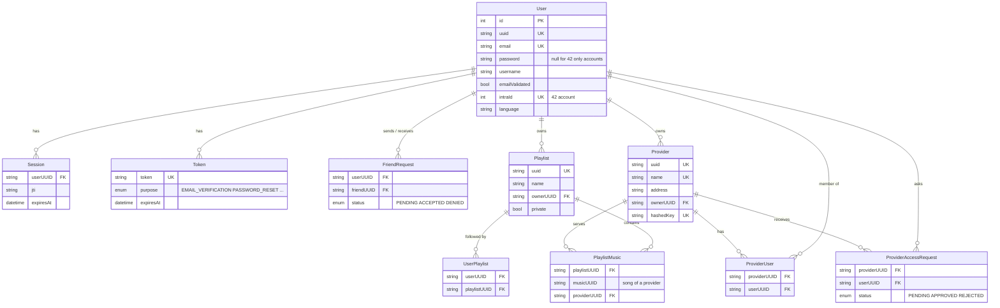
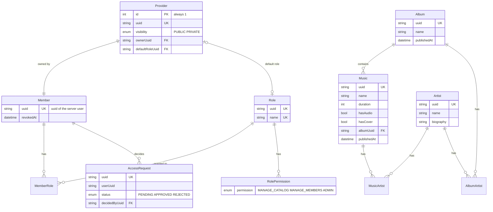

*This project has been created as part of the 42 curriculum by lilefebv, ebini, ethebaul, vaamonch.*

# Flex — ft_transcendence

## Description

Flex is a music streaming website where the music is not stored on one central server.
Anyone can run a **provider**: a small server that holds a music catalog (songs, albums, artists, covers, audio files) and chooses who can listen to it.
The Flex server manages the accounts, friends, chat and playlists, and tells the browser which providers a user can use.
A playlist can mix songs from several providers, and the browser plays each song directly from its provider.

### Key features

- Full account system, 42 OAuth, and email verification / account recovery.
- Profiles with avatar, friends and online presence.
- Ephemeral chat between friends.
- Playlists: create, rename, public/private, custom cover, delete, follow the public playlists of other users.
- Self hosted providers with your own catalog, members, permissions and access management.
- Search with filters, sort and infinite scroll.
- Audio player with queue and listening history.
- Public API with a personal API key.
- Interface in four languages (English, French, Spanish, Japanese), with a light and a dark theme.
- Docker deployment (read-only containers, Docker secrets, HTTPS), CI on every pull request.

## Instructions

### Prerequisites

- Docker and Docker Compose, `make`, and `openssl` (used to generate the secrets).
- For local development without Docker images: Node.js >= 26 and [pnpm](https://pnpm.io) 12.
- A [42 API application](https://profile.intra.42.fr/oauth/applications) if you want the 42 login (redirect URI: `https://<FRONT_HOST>[:<FRONT_PORT>]/auth/42/auth-callback`, without the port when it is 443).
- An SMTP account (email verification and password reset).

### Where things are

- **Production** is at the root: `docker-compose.yml` (server) and `docker-compose.provider.yml` (providers), `.env` and `.env.provider-<name>` for the settings, `secrets/server/` and `secrets/provider-<name>/` for the secrets, `docker/` for the Docker helpers and the nginx templates. The Makefile drives all of it.
- **Development** is in the applications and in `scripts/dev/`: `back/.env.example`, `front/.env.example`, `provider/.env.example`, pnpm scripts, seed scripts in the `dev/` folders.

### Run the server (database, migrations, back, front)

```bash
make secrets-server    # creates secrets/server/ and .env (from .env.example)
```

Then fill in `.env` (host and ports of the site, SMTP server, 42 application) and put the SMTP password and the 42 secret in `secrets/server/smtp_pass` and `secrets/server/api42_client_secret`.

```bash
make server            # docker compose up -d --build --wait
```

The site is served by nginx in HTTPS on `FRONT_PORT` (443 by default). `FRONT_HTTP_PORT` (80) redirects to it. The host and both ports are set in `.env`, and the public address of the site (`https://<FRONT_HOST>:<FRONT_PORT>`, used for the 42 login and the emails) is computed from them. The front calls the back through `/api`.
The database is only reachable from the stack, and the migrations are applied by the `migrate` service before the back starts.

Everything sensitive is a [Docker secret](https://docs.docker.com/compose/how-tos/use-secrets/), a file of `secrets/server/`
mounted in `/run/secrets` (the `NAME_FILE` variables are resolved by [docker/entrypoint.sh](docker/entrypoint.sh)):

| File | Content |
| --- | --- |
| `postgres_password`, `jwt_secret`, `jwt_refresh_secret` | random, generated |
| `provider.pem` | RSA key signing the provider tokens, generated |
| `tls.crt`, `tls.key` | certificate and key of nginx: self-signed when generated, **replace them with a real certificate** in production (`DOMAIN=example.com make secrets-server` adds a name to the self-signed one) |
| `smtp_pass`, `api42_client_secret` | to fill in by hand |

Existing files are never overwritten. Nothing is seeded in production: the database starts empty and the first account is created from the site.

`GET /api/health` answers 503 when the back cannot reach the database.

### Run a provider (database, migrations, provider, nginx)

Every provider has a name (lowercase letters, digits and dashes), which is required by all the provider commands. Each one has its own secrets, settings, ports and Docker project (`flex-provider-<name>`, so its own database), so several providers can run on the same machine.

```bash
make secrets-provider NAME=music    # creates secrets/provider-music/ and .env.provider-music (from .env.provider.example)
```

Then:
1. Edit `.env.provider-music`: the address of the server (`FLEX_SERVER_URL`), and the host and ports of the provider (`PROVIDER_HOST`, `PROVIDER_PORT`, `PROVIDER_HTTP_PORT`). Use other ports for each provider of the same machine.
2. Create the provider on the app (from the *Providers* page), with the public address `https://<PROVIDER_HOST>:<PROVIDER_PORT>`. It gives the API key, shown once: put it in `secrets/provider-music/flex_api_key`.

```bash
make provider NAME=music            # docker compose up -d --build --wait for this provider
```

The provider is served in HTTPS by its own nginx on `PROVIDER_PORT`; `PROVIDER_HTTP_PORT` redirects to it. `tls.crt` and `tls.key` work like the server's.
`server_ca.crt` is the certificate (or CA) of the server, trusted by the provider when it calls it: the generator copies the server's self-signed certificate from `secrets/server/tls.crt` if it exists.

`FLEX_SERVER_URL` must be reachable from the container and end with `/api` when it targets the Docker front (`https://host.docker.internal:<FRONT_PORT>/api` for a server on the same machine).
The address registered on the server is the one browsers use to reach the provider (`https://…`), not a container name.

`make server-down` / `provider-down NAME=music` stop a stack (the volumes are kept), `server-logs` / `provider-logs NAME=music` follow its logs,
`server-reset` / `provider-reset NAME=music` delete its data (they ask for `CONFIRM=yes`).

### Development

The Makefile only drives the production stacks (Docker). Everything for development goes through pnpm scripts, and the development settings are the `.env.example` files of `back`, `front` and `provider` (production settings are the ones at the root).

```bash
pnpm install          # every package of the workspace
pnpm run dev          # development database (Docker), migrations, test accounts, then back and front with hot reload
pnpm run dev:provider1   # a provider with a mock catalog (optional, in another terminal)
```

Test accounts (development only): `liam@test.com`, `chantal@test.com` and `machin@test.com`, password `abcdefgh`.
The mock catalog of the providers lives in `provider/mock`, the seed scripts are in the `dev/` folders of `back` and `provider`, and the other development tools (database in Docker, YouTube audio download, Discord presence) are in `scripts/` (`pnpm --filter @flex/provider run seed:search` fills a provider with a large search test catalog).
These folders are not part of the production images.

`pnpm run dev:front` starts the front end only. The back and the provider read `shared/src` directly in development (`paths` in their `tsconfig.json`), so `shared` does not need to be built to run them.
`shared/dist` is only needed by production builds (`tsconfig.build.json` ignores these `paths`), the Docker images and the front's type-check: `pnpm run build:shared`.
`pnpm run lint` and `pnpm run check` lint and type-check the whole workspace.
New migration: `pnpm run migrate:back --name what_you_changed` (or `migrate:provider`). `pnpm run reset:back` / `reset:provider` recreate a development database.

### Hardening and logs

Every container drops all Linux capabilities (Postgres keeps the few it needs to start), cannot gain new privileges and has a read-only filesystem: only the volumes and a `/tmp` in memory are writable. Docker logs are rotated (3 files of 10 MB).
CI builds the three images and starts the server stack (`docker-stack` job) on each pull request.

## Resources

- [NestJS](https://docs.nestjs.com), [SolidJS](https://docs.solidjs.com), [Prisma](https://www.prisma.io/docs), [PostgreSQL](https://www.postgresql.org/docs/16/), [ParadeDB](https://docs.paradedb.com)
- [ts-rest](https://ts-rest.com), [Zod](https://zod.dev), [TanStack Query](https://tanstack.com/query/v4), [Socket.IO](https://socket.io/docs/v4/)
- [OAuth 2.0 (RFC 6749)](https://datatracker.ietf.org/doc/html/rfc6749), [JWT (RFC 7519)](https://datatracker.ietf.org/doc/html/rfc7519), [42 API](https://api.intra.42.fr/apidoc), [OWASP Cheat Sheets](https://cheatsheetseries.owasp.org)

### Use of AI

We used AI assistants (such as Claude Code) as a help, not as a replacement: every change was read, tested and committed by a team member.

- **Tasks:** code review and bug hunting, writing and refactoring code, explaining the stack (NestJS, SolidJS, Prisma, ts-rest) and writing documentation.
- **Parts of the project:** the real-time layer (chat, friends, presence), playlists, provider management, search (sorting, infinite scroll), and this README.

## Team

| Member | Role(s) | Responsibilities |
| --- | --- | --- |
| Erwoan (ethebaul) | Product Owner, Developer | Decides what the product should do and in which order, keeps the backlog, validates finished work. |
| Liam (lilefebv) | Project Manager, Developer | Organizes the meetings and the planning, follows progress and deadlines, helps unblock the others. |
| Emilien (ebini) | Technical Lead, Developer | Chooses the architecture and the technologies, takes care of code quality, reviews the important changes. |
| Vadim (vaamonch) | Developer | Builds and tests features and modules, and documents them. |

## Project management

- **Organization:** one GitHub issue and one branch per task (`<issue number>-<name>`), merged with a pull request that another member reviews.
- **Tools:** GitHub Issues and Pull Requests, GitHub Actions (lint, type-check and Docker build on every pull request).
- **Communication:** a Discord server for everyday discussions, and meetings in person at the campus.

## Technical stack

| Part | Technologies |
| --- | --- |
| Front end | [SolidJS](https://www.solidjs.com), TypeScript, Vite, TanStack Query, Sass, lucide icons, socket.io-client |
| Server | [NestJS](https://nestjs.com) 11, Passport / JWT, Socket.IO, Prisma 7, sharp, Nodemailer, Swagger |
| Provider | NestJS, Prisma, music-metadata, multer |
| Shared | `shared` package: [ts-rest](https://ts-rest.com) contracts and [Zod](https://zod.dev) schemas used by the three applications |
| Databases | PostgreSQL 16 (server), [ParadeDB](https://www.paradedb.com) = PostgreSQL with ranked full-text search (providers) |
| Infrastructure | Docker Compose, nginx (HTTPS), Docker secrets, GitHub Actions, pnpm workspace |

**Why these choices.** The three applications talk to each other, so we put the routes in one shared package (ts-rest + Zod). It types the clients, validates the servers and generates the API documentation, so they cannot get out of sync.
NestJS gives us modules, guards and interceptors, which helps with an API that has several kinds of authentication (user token, provider API key, provider token). SolidJS is light and fast to update, which suits a player, presence dots and a chat that change all the time.
We use a relational database for users, friendships, playlists and memberships. ParadeDB (PostgreSQL with full-text search) gives the providers a ranked search that tolerates typos.

## Database schema

### Server database (PostgreSQL)



A song only exists in the catalog of its provider: the server only stores a reference (`musicUUID`, `providerUUID`). `AppConfig` (key / value) holds the 42 application credentials.

### Provider database (ParadeDB)



## Features

| Feature | Description | Who |
| --- | --- | --- |
| Authentication | Email and password with email verification and password reset, 42 OAuth (login, link and unlink an account), short-lived access token plus a refresh cookie. | Liam |
| Profile and settings | Change the username, email and password, upload an avatar (there is a default one), choose the language and the light or dark theme. | Emilien |
| Friends and presence | Send, accept, decline and remove friend requests, see who is online in real time. | Vadim |
| Chat | Ephemeral chat between online friends. Friend requests and other friend events reach the other user instantly through WebSockets. | Vadim |
| Playlists | Create, rename, make public or private, set a cover, delete; add and remove songs from any provider; follow and unfollow the public playlists of other users. | Erwoan, Emilien, Liam |
| Providers | Create, edit and delete a provider, regenerate its API key, access requests that are accepted automatically (public provider) or by a manager. | Erwoan |
| Provider management | Manage members and roles (`MANAGE_CATALOG`, `MANAGE_MEMBERS`, `ADMIN`), create, edit and delete songs, albums and artists with audio and cover upload. | Liam, Emilien |
| Search | Search users, playlists, providers and the catalog of all your providers. The catalog can be filtered (song, album, artist, dates), sorted (by column or by provider) and loads more results as you scroll. | Erwoan |
| Player | Queue, shuffle, repeat, listening history on the home page, browser media controls. | Emilien |
| Public API | Personal API key, hourly quota, 9 endpoints on the profile and the playlists, Swagger documentation at `/api/swagger`. | Vadim |
| Deployment | Docker images, hardened containers (no capabilities, read-only filesystem), Docker secrets, HTTPS, health checks and CI. | Erwoan |

## Modules

Major = 2 points, Minor = 1 point.

| Module | Type | Points | Justification / implementation | Who |
| --- | --- | --- | --- | --- |
| Framework for frontend and backend | Major | 2 | SolidJS for the front, NestJS for the server and the provider. | Whole team |
| Users interacting with each other | Major | 2 | Chat, profile pages, friends system with presence. | Emilien, Vadim |
| Standard user management and authentication | Major | 2 | Profile update, avatar with default, friends and online status, profile page. | Liam, Emilien, Vadim |
| Advanced permissions system | Major | 2 | Roles and permissions in each provider: manage members and roles, and what a user sees or can do depends on their permissions. | Liam, Emilien |
| Public API | Major | 2 | Personal API key (stored hashed, sent as a Bearer token), rate limiting and an hourly quota, Swagger documentation, 9 endpoints (`GET`, `POST`, `PUT`, `PATCH`, `DELETE`). | Vadim |
| Custom module: decentralized providers | Major | 2 | See below. | Erwoan, Liam, Emilien |
| ORM for the database | Minor | 1 | Prisma on both databases, with migrations. | Erwoan, Liam, Vadim |
| Custom design system | Minor | 1 | More than ten reusable components (Button, TextInput, Select, Checkbox, Toggle, Form, pop-ups, Toaster, Menu, Tabs, SortBar, cards…), a color palette with light and dark themes, fonts and icons. | Emilien |
| Advanced search | Minor | 1 | Catalog search with filters, sorting (by column or by provider) and results loaded page by page while scrolling. | Erwoan |
| File upload and management | Minor | 1 | Avatars, playlist covers, audio and cover files on providers: type and size checks on the front and the back, previews, progress bars, deletion, and access to the files with provider media tokens. | Erwoan, Liam |
| OAuth 2.0 remote authentication | Minor | 1 | 42 login, and linking or unlinking a 42 account to an existing account. | Liam |
| Multiple languages | Minor | 1 | Translation system with a language picker. All the texts are translated in four languages: English, French, Spanish and Japanese. | Liam, Emilien |
| Support for additional browsers | Minor | 1 | Firefox and Chromium-based browsers, see below. | Whole team |

**Total: 19 points** (12 from the six major modules, 7 from the seven minor modules).

### Custom major module: decentralized providers

- **Why:** a streaming service usually owns its whole catalog. Here the owners of the catalogs keep their content and choose who can listen to it. It works for independent artists, labels, or friends who want to share a collection.
- **Challenges:** three applications have to trust each other without sharing a database.
  - The server signs short-lived tokens for one provider only (RS256, one audience per provider), and the provider checks them with the server's public key.
  - Joining a provider takes two steps: the user asks the server, then the provider checks that request with the server before creating its own.
  - A provider is a server of its own, with its own database, roles, media storage and migrations. You can run several of them on one machine.
  - The front mixes songs from several providers in the same playlist and keeps one token per provider.
- **Why it is a major module:** most of the project is built around it (playlists, access requests, roles, catalog, search, media). It is a second full back end (catalog, media, permissions), plus the trust and token system between the applications, plus the front end that works with several providers at once.

### Browser support

The site is used and checked on Firefox and on Chromium-based browsers (Chromium, Chrome). Known differences: the date picker of the search filters looks different in each browser (the filters have a fixed height to keep the same layout), and the browser media controls (Media Session API) are not the same everywhere.

## Individual contributions


### Erwoan (ethebaul)
- Features / modules: playlists, providers (creation, API key, access protocol), search, Docker deployment and CI; modules custom providers, ORM, advanced search, file upload.
- Challenges and solutions: learning a new web stack (NestJS and SolidJS) and learning how to organize the shared ts-rest contracts and the Prisma schemas. Overcome by learning while building the providers and the search, with one shared contract per route so the front and the back stay in sync.

### Liam (lilefebv)
- Features / modules: authentication (email, 42 OAuth), playlists, provider management (members, roles, catalog); modules standard user management, advanced permissions, custom providers, ORM, file upload, OAuth, multiple languages.
- Challenges and solutions: discovering NestJS and SolidJS. Overcome by learning them while building the authentication, the playlists and the provider management.

### Emilien (ebini)
- Features / modules: profile and settings, playlists, provider management, player, design system; modules users interacting, standard user management, advanced permissions, custom providers, design system, multiple languages.
- Challenges and solutions: thinking through the architecture of the whole project (server, providers, shared contracts) and the technical choices before building on them.

### Vadim (vaamonch)
- Features / modules: friends and presence, chat and real-time events, public API; modules users interacting, standard user management, public API, ORM.
- Challenges and solutions: learning NestJS, SolidJS and Prisma. Overcome by learning them while building the friends system, the chat and the public API.

## Known limitations

- Chat messages are ephemeral on purpose: they are not stored and they are not delivered to offline users.
- A provider's API key is regenerated from the website, and the new key must then be copied into the secrets of the provider.
- Search shows at most the first 100 results of each provider (the infinite scroll stops there).

## Documentation

- Public API: create a key in *Settings → API*, then send it as `Authorization: Bearer <key>`. The documentation is at `/api/swagger`.
- Design notes: [docs/modules.md](docs/modules.md), [docs/roles.md](docs/roles.md), [scripts/discord/README.md](scripts/discord/README.md).
