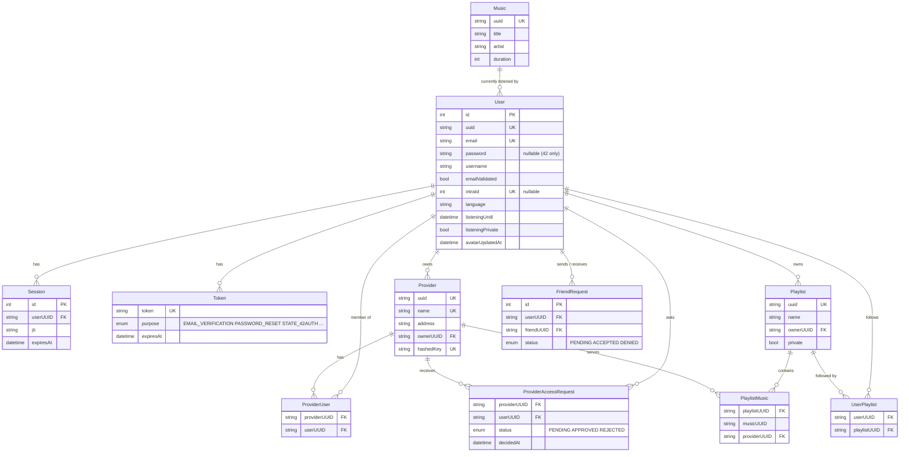
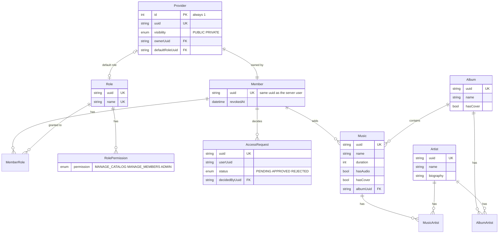

*This project has been created as part of the 42 curriculum by <login1>, <login2>, <login3>, <login4>.*
<!-- TODO: replace with the 42 logins of the four team members (Erwoan, Liam, Emilien, Vadim) -->

# Flex — ft_transcendence

## Description

**Flex** is a music streaming platform where the music is not hosted by one central server.
Anyone can run their own **provider**: a small self-hosted server that owns a music catalog (songs, albums, artists, covers, audio files) and decides who may listen to it.
The Flex **server** ties everything together: it handles accounts, friends, chat, playlists, and tells the browser which providers a user can reach.
A playlist can mix songs coming from several providers, and the browser talks directly to each provider to stream them.

The goal is a social music experience (profiles, friends, live presence, chat, shared playlists) on top of an architecture where catalog owners keep control of their content.

### Key features

- Account system with email/password, email verification and **42 OAuth** login, refresh-token sessions.
- Profiles with avatar, "currently listening" status, and friends with **live online presence**.
- **Ephemeral real-time chat** between friends and real-time friend events over WebSockets.
- Playlists: create, rename, public/private, custom cover, delete, follow other people's playlists.
- **Self-hosted providers** with their own catalog, members, roles and permissions, and an access request flow (public or approval-based).
- Search with filters and pagination, audio player with queue, listening history.
- Hardened Docker deployment (read-only containers, Docker secrets, HTTPS), CI on every pull request.

## Instructions

### Prerequisites

- Docker and Docker Compose, `make`, and `openssl` (used to generate the secrets).
- For local development without Docker images: Node.js >= 26 and [pnpm](https://pnpm.io) 12.
- A [42 API application](https://profile.intra.42.fr/oauth/applications) if you want the 42 login (redirect URI: `<BASE_FRONT_URL>/auth/42/auth-callback`).
- An SMTP account (email verification and password reset).

### Run the server (database, migrations, back, front)

```bash
cp .env.example .env        # fill in the public URL, the SMTP server and the 42 application
make secrets                # creates secrets/ (see below)
make server                 # docker compose up -d --build --wait
```

The site is served by nginx in HTTPS on `FRONT_PORT` (443 by default). `FRONT_HTTP_PORT` (80) redirects to `BASE_FRONT_URL`. The front calls the back through `/api`.
The database is only reachable from the stack, and the migrations are applied by the `migrate` service before the back starts.

Everything sensitive is a [Docker secret](https://docs.docker.com/compose/how-tos/use-secrets/), a file of `secrets/`
mounted in `/run/secrets` (the `NAME_FILE` variables are resolved by [docker/entrypoint.sh](docker/entrypoint.sh)):

| File | Content |
| --- | --- |
| `postgres_password`, `jwt_secret`, `jwt_refresh_secret` | random, generated |
| `provider.pem` | RSA key signing the provider tokens, generated |
| `tls.crt`, `tls.key` | certificate and key of nginx: self-signed when generated, **replace them with a real certificate** in production (`DOMAIN=example.com make secrets` adds a name to the self-signed one) |
| `smtp_pass`, `api42_client_secret` | to fill in by hand |

Existing files are never overwritten. Test accounts are seeded in `dev` only.

`GET /api/health` answers 503 when the back cannot reach the database.

### Run a provider (database, migrations, provider, nginx)

Create the provider on the server first (from the *Providers* page): it gives the API key, shown once.

```bash
cp provider/.env.example provider/.env        # FLEX_SERVER_URL, POSTGRES_*
make secrets-provider   # then put the API key in provider/secrets/flex_api_key
make provider           # docker compose -f provider/docker-compose.yml up -d --build --wait
```

The provider is served in HTTPS by its own nginx on `PROVIDER_PORT` (443 by default, to change if the server runs on the same machine); `PROVIDER_HTTP_PORT` (80) redirects to `PROVIDER_URL`, its public address; `tls.crt` and `tls.key` work like the server's.
`secrets/server_ca.crt` is the certificate (or CA) of the server, trusted by the provider when it calls it: the generator
copies the server's self-signed certificate if `secrets/tls.crt` exists.

`FLEX_SERVER_URL` must be reachable from the container and end with `/api` when it targets the Docker front
(`https://host.docker.internal:<FRONT_PORT>/api` for a server on the same machine).
The `provider` URL registered on the server is the one browsers use to reach it (`https://…`), not a container name.

`make server-down` / `provider-down` stop a stack (the volumes are kept), `server-logs` / `provider-logs` follow its logs.

**Several providers on one machine.** `make provider NAME=1` runs a second provider next to the default one: its own Docker project (`flex-provider-1`, so its own
database volume), its settings in `provider/.env.1` (copy `provider/.env.example` and change `PROVIDER_PORT`,
`PROVIDER_HTTP_PORT` and `PROVIDER_URL`) and its secrets in `provider/secrets.1` (`make secrets-provider NAME=1`, then put the
API key of this provider in `flex_api_key`). `NAME` works the same way with `provider-down`, `provider-logs`, `provider-seed`
and `provider-reset`. Without `NAME`, they act on the default provider.

### Development

```bash
pnpm install        # every package of the workspace
make run            # database in Docker (docker-compose.dev.yml) + back and front with hot reload
make provider       # a provider (optional)
```

`pnpm run dev:front` starts the front end only. The back and the provider read `shared/src` directly in development (`paths` in their `tsconfig.json`), so `shared` does not need to be built to run them.
`shared/dist` is only needed by production builds (`tsconfig.build.json` ignores these `paths`), the Docker images and the front's type-check: `pnpm run build:shared`.
`pnpm run lint` and `pnpm run check` lint and type-check the whole workspace. New migration: `make migrate-back NAME=what_you_changed` (or `migrate-provider`).

### Hardening and logs

Every container drops all Linux capabilities (Postgres keeps the few it needs to start), cannot gain new privileges and has a
read-only filesystem: only the volumes and a `/tmp` in memory are writable. Docker logs are rotated (3 files of 10 MB).
CI builds the three images and starts the server stack (`docker-stack` job) on each pull request.

## Resources

- [NestJS](https://docs.nestjs.com), [Prisma](https://www.prisma.io/docs), [PostgreSQL](https://www.postgresql.org/docs/16/), [ParadeDB](https://docs.paradedb.com)
- [SolidJS](https://docs.solidjs.com), [TanStack Query](https://tanstack.com/query/v4), [Vite](https://vite.dev)
- [ts-rest](https://ts-rest.com) (typed contracts shared by the back, the provider and the front), [Zod](https://zod.dev)
- [Socket.IO](https://socket.io/docs/v4/), [OAuth 2.0 (RFC 6749)](https://datatracker.ietf.org/doc/html/rfc6749), [42 API documentation](https://api.intra.42.fr/apidoc)
- [JSON Web Tokens (RFC 7519)](https://datatracker.ietf.org/doc/html/rfc7519), [OWASP Cheat Sheet Series](https://cheatsheetseries.owasp.org)
- [Docker secrets](https://docs.docker.com/compose/how-tos/use-secrets/), [Docker Compose](https://docs.docker.com/compose/)

### Use of AI

<!-- TODO: each team member must complete this section with their own real usage -->
AI assistants (Claude Code) were used as a pair-programming and review tool, never as the only author of a change: every change was read, tested and committed by a team member.
They were used for:

- reviewing branches and pull requests (spotting bugs, missing error handling, security issues);
- implementing and refactoring parts of the real-time layer (friend events, ephemeral chat, token renewal over WebSocket), the playlist edition (rename, privacy, cover, delete) and some front pages;
- diagnosing production-like problems from logs (rate limiting, OAuth errors);
- drafting this README from the code and the subject.

## Team

| Member | Role(s) | Responsibilities |
| --- | --- | --- |
| Erwoan | Product Owner, Developer | Defines the product vision and priorities, maintains the backlog, validates finished work. |
| Liam | Project Manager / Scrum Master, Developer | Organizes meetings and planning, tracks progress and deadlines, removes blockers. |
| Emilien | Technical Lead / Architect, Developer | Defines the architecture and the technology stack, ensures code quality, reviews critical changes. |
| Vadim | Developer | Implements features and modules, takes part in code reviews, tests and documents his work. |

<!-- TODO: check that the roles match reality (docs/roles.md) and add the 42 logins -->

All members also write code, take part in reviews and test their work.

## Project management

- **Organization:** work is split in issues, one branch per issue (`<issue number>-<short-name>`), merged through pull requests reviewed by another member.
- **Tools:** GitHub Issues and Pull Requests, GitHub Actions for the checks (lint, type-check and Docker build on every pull request, see `.github/workflows`).
- **Communication:** <!-- TODO: Discord / Slack / meetings, frequency --> to be completed.

## Technical stack

| Part | Technologies |
| --- | --- |
| Front end | [SolidJS](https://www.solidjs.com) + TypeScript, Vite, [@solidjs/router](https://github.com/solidjs/solid-router), TanStack Query, Sass, lucide icons, socket.io-client |
| Back end (server) | [NestJS](https://nestjs.com) 11 + TypeScript, Passport/JWT, Socket.IO gateway, Prisma 7, sharp (images), Nodemailer, Winston, Swagger |
| Provider | NestJS, Prisma, music-metadata (audio tags), image-size, multer (uploads) |
| Shared | `shared` package: [ts-rest](https://ts-rest.com) contracts and [Zod](https://zod.dev) schemas used by the three apps |
| Databases | PostgreSQL 16 for the server, [ParadeDB](https://www.paradedb.com) (PostgreSQL with full-text search) for the providers |
| Infrastructure | Docker Compose, nginx (HTTPS, reverse proxy), Docker secrets, GitHub Actions, pnpm workspace |

### Justification of the main choices

- **A monorepo with a shared contract package.** The three applications talk to each other (front ↔ back, front ↔ provider, provider ↔ back). ts-rest + Zod give one definition of each route that types the client, validates the server and the responses, and generates the OpenAPI documentation, so the apps cannot drift apart.
- **NestJS** for the back and the provider: modules, dependency injection, guards and interceptors fit an API with several authentication levels (user JWT, provider API key, provider-scoped access tokens).
- **SolidJS** for the front: fine-grained reactivity avoids re-rendering while the player, the presence dots and the chat update many times per second, with a small runtime.
- **Prisma** as ORM: typed queries and versioned migrations for both databases.
- **PostgreSQL**: relational data (users, friends, playlists, memberships) with integrity constraints. The providers use ParadeDB for ranked full-text search over their catalog.
- **Socket.IO** for presence, chat and friend events: rooms per user, automatic reconnection, typed events shared through `shared`.

## Database schema

### Server database



`AppConfig` (key/value) stores the 42 application credentials. A song only exists in a provider's catalog: the server stores `PlaylistMusic(musicUUID, providerUUID)` references and a small `Music` cache for the "currently listening" status.

### Provider database



## Features

<!-- TODO: fill in the "Who" column with the real contributors of each feature -->

| Feature | Description | Who |
| --- | --- | --- |
| Authentication | Email/password with verification email and password reset, 42 OAuth login/link/unlink, short-lived access token + httpOnly refresh cookie (stored sessions). | |
| Profile & settings | Username, language, avatar upload (resized to WebP) with default avatar, listening privacy. | |
| Friends & presence | Send/accept/decline/remove requests, live online/offline status through WebSocket. | |
| Chat | Ephemeral one-to-one chat between online friends, with a shared message contract and error codes. | |
| Real-time events | Friend requests, acceptances, removals and token renewal pushed over the socket; caches are updated without reloading. | |
| Playlists | Create, rename, public/private, custom cover, delete with confirmation, follow/unfollow, add or remove songs from any provider. | |
| Providers | Register a provider, API key (shown once, regenerable), address, members, access requests (automatic for public providers). | |
| Provider catalog | Songs, albums and artists with audio/cover upload and tag extraction, management restricted by roles. | |
| Roles & permissions | Per-provider roles (`MANAGE_CATALOG`, `MANAGE_MEMBERS`, `ADMIN`), default role for new members, member revocation. | |
| Search | Search for users, playlists, providers and catalog content with filters, sorting and pagination (ranked full-text search in providers). | |
| Player | Queue, shuffle, media session integration, listening history. | |
| Design system | Reusable inputs, buttons, overlays, toaster, cards, tabs, themed with design tokens. | |
| Deployment | Docker images, hardened containers, Docker secrets, HTTPS, health check, CI. | |

## Modules

<!-- TODO: confirm every module below is really finished before the evaluation -->

Major = 2 points, Minor = 1 point.

| Module | Type | Points | Justification / implementation | Who |
| --- | --- | --- | --- | --- |
| Framework for frontend and backend | Major | 2 | SolidJS for the front, NestJS for the back and the provider. | |
| Users interacting with each other | Major | 2 | Chat, profile pages, friends system with presence. | |
| Standard user management and authentication | Major | 2 | Profile update, avatar with default, friends and online status, profile page. | |
| Advanced permissions system | Major | 2 | Roles and permissions per provider (members, roles, `MANAGE_*` permissions, admin), different views and actions according to the role. | |
| Custom module: decentralized provider architecture | Major | 2 | See below. | |
| ORM for the database | Minor | 1 | Prisma on both databases, with versioned migrations. | |
| Custom design system | Minor | 1 | More than ten reusable components (Button, TextInput, Select, Toggle, Form, Overlay/pop-ups, Toaster, Tabs, cards…), colour tokens, typography and icons. | |
| Advanced search | Minor | 1 | Filters, sorting and pagination on users, playlists, providers and catalog. | |
| File upload and management | Minor | 1 | Avatars, playlist covers, audio and cover files on providers, with client and server validation of type and size and deletion. | |
| Multiple languages | Minor | 1 | i18n system with a language switcher. | |
| Additional browsers | Minor | 1 | Tested on Firefox and Chromium-based browsers. | |
| OAuth 2.0 remote authentication | Minor | 1 | 42 login, with the possibility to link/unlink an existing account. | |
| Health check and status | Minor | 1 | `/api/health` and the provider `/health`, shown in the UI as the provider status. | |

**Total: 18 points** (10 from major modules, 8 from minor modules).

### Custom major module: decentralized provider architecture

- **Why:** a streaming service normally owns its catalog. Here, catalog owners keep their content and decide who may listen, which makes the platform usable for independent artists, labels or friends sharing a collection, and shows a realistic multi-party architecture.
- **Technical challenges:**
  - three applications that must trust each other without sharing a database: the server signs short-lived, provider-scoped JWTs (RS256, one audience per provider), and the provider verifies them with the server's public key;
  - a two-step access protocol (the user asks the server, then the provider checks that request with the server before creating its own), with the provider authenticating to the server with an API key;
  - a provider is an independent server with its own database, roles, permissions, media storage and migrations, deployable several times on the same machine;
  - the front aggregates several providers inside a single playlist and refreshes one token per provider.
- **Added value:** the whole project (playlists, access requests, roles, catalog, search, media) is built around it.
- **Why Major:** it is a second full back end (catalog, media pipeline, permissions) plus the server-side trust and token infrastructure and the front-end orchestration across origins.

## Individual contributions

<!-- TODO: each member completes their own section (features, modules, difficulties and how they were solved) -->

### Erwoan
- Features / modules:
- Challenges and solutions:

### Liam
- Features / modules:
- Challenges and solutions:

### Emilien
- Features / modules:
- Challenges and solutions:

### Vadim
- Features / modules:
- Challenges and solutions:

## Known limitations

- Chat messages are ephemeral on purpose: they are neither stored nor delivered to offline users.
- Regenerating a provider's API key is done on the server and the new key must then be copied into the provider's secrets.

## Documentation

- Swagger documentation of the server API is exposed in development.
- Design notes: [docs/modules.md](docs/modules.md), [docs/roles.md](docs/roles.md), [scripts/presence.md](scripts/presence.md).
